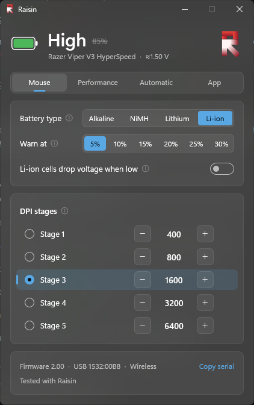

<p align="center">
  
</p>

<h1 align="center">Raisin</h1>

<p align="center">
  A tiny, fast replacement for Razer Synapse, for 118 Razer mice.<br>
  DPI stages, polling rate, battery, scroll wheel and sleep settings, from a ~500 KB exe that idles at about 2 MB of memory.
</p>

<p align="center">
  <a href="https://github.com/bladestech/Raisin/actions/workflows/ci.yml"></a>
  <a href="LICENSE"></a>
  
</p>

<p align="center">
  
</p>

## Why

Synapse is a large Electron app with several background services, and it typically uses hundreds of megabytes of memory to change a few settings that mostly live on the mouse itself. Raisin talks to the mouse directly and gets out of the way.

| | Raisin |
|---|---|
| Download | one `raisin.exe`, about 500 KB, no installer |
| Memory, in the tray | about 2 MB |
| Memory, settings window open | about 11 MB (a separate process that exits when you close it) |
| Drivers or services | none |

## Features

- **DPI stages**: up to 5 stages, pick the active one, edit values with steppers or the scroll wheel. Mice without stages get a single DPI control.
- **Polling rate**: whatever your mouse supports, from 125 Hz up to 8000 Hz on HyperPolling models.
- **Battery**: level, charging status, approximate cell voltage on AA mice, and a tray icon gauge that turns orange and red as it drains.
- **Battery type** (AA mice): Alkaline, NiMH or Lithium discharge curves, plus a **Li-ion 1.5 V** profile for regulated rechargeable AAs that shows **High** or **Low** instead of a misleading percentage (see [Battery notes](#battery-notes)).
- **Low-battery warning**: set where the mouse starts blinking red (5 to 30%), with a matching Windows notification.
- **Scroll wheel** (Basilisk V3 family): free spin or tactile, scroll acceleration, Smart Reel.
- **Sleep timer**: 1 to 15 minutes.
- **Power modes**: one click for **Power Saver** (lowest polling rate, 1-minute sleep), **Balanced** (1000 Hz, 5 minutes) or **Max** (the fastest rate your mouse supports, 5 minutes).
- **Automatic switching**: per-app rules (for example Max and DPI stage 4 while a game is in front) and Power Saver while your laptop runs on battery or energy saver. Your own settings come back afterwards.
- **Info bubbles**: hover an (i) next to a setting to see what it does.
- **Mouse details**: model, firmware version, USB ID, connection, and a one-click serial number copy for warranty claims.
- **Tray icon**: battery gauge, logo, or alternating between them.
- **Start with Windows**, and a **command line** for scripts and hotkeys.

The settings window only shows what your mouse supports, and settings are written to the mouse's own memory, so they stick even when Raisin isn't running. No RGB lighting control, by design.

## Supported mice

Raisin knows **118 Razer mice**, from the 2012 Naga to the Viper V4 Pro, including wired, wireless and HyperPolling models. See the [full list](docs/devices.md) or run `raisin devices`.

| Status | Models |
|---|---|
| Tested with Raisin | Razer Viper V3 HyperSpeed (`1532:00B8`) |
| Supported, untested | 117 more, using device details from [OpenRazer](https://github.com/openrazer/openrazer) |

The protocol is shared across these mice and the details per model come from OpenRazer's well-tested Linux driver, so untested models are expected to work. If yours does (or doesn't), please [open an issue](https://github.com/bladestech/Raisin/issues/new?template=device_request.yml) with the output of `raisin info`, so it can be marked tested or fixed. A few very old mice that use a different protocol (DeathAdder 3.5G, Orochi 2011) aren't supported.

## Install

1. Download `raisin.exe` from the [latest release](https://github.com/bladestech/Raisin/releases/latest).
2. Run it. The tray icon appears; left-click it for settings, right-click for the quick menu.
3. Optional: turn on **Start Raisin with Windows** in settings.

Requirements: Windows 10 or 11 (x64). The acrylic window background needs Windows 11; Windows 10 gets a solid background. Raisin needs the Microsoft Visual C++ runtime, which most PCs already have. If it won't start, install the [Visual C++ Redistributable](https://learn.microsoft.com/cpp/windows/latest-supported-vc-redist).

The exe isn't code-signed yet, so Windows SmartScreen may warn the first time you run it. Choose **More info**, then **Run anyway**.

If Synapse is installed, quit it first: it overwrites settings and can hold the mouse.

## Usage

**Tray icon:** hover for battery, DPI and polling rate. Left-click opens settings; right-click opens a menu with the same options.

**Command line:**

```text
raisin                      run in the system tray
raisin info                 mouse, firmware, battery, DPI, polling rate and more
raisin dpi <n>              set the current DPI
raisin stages <a,b,...>     set 1-5 DPI stages (keeps the active stage)
raisin stage <n>            switch to stage n
raisin poll <hz>            polling rate (info lists what your mouse supports)
raisin sleep <seconds>      sleep timer, 60-900
raisin power <saver|balanced|max>
                            power mode (polling rate + sleep timer)
raisin lowbat <5-30>        red low-battery blink threshold, percent
raisin battery <alkaline|nimh|lithium|liion|liion-step>
raisin scroll <tactile|freespin>
raisin accel <on|off>       scroll acceleration
raisin smartreel <on|off>
raisin devices              list supported mice
raisin probe                list Razer HID interfaces (for bug reports)
raisin scan [ids]           read-only dump of battery-class commands
raisin --settings           open just the settings window
```

## Battery notes

The mouse turns cell voltage into a percentage using a discharge curve for the battery type you choose. A wrong type gives wrong readings: on the **Lithium** curve, which expects about 1.8 V when full, a fresh 1.5 V alkaline reads only around 40%.

**Li-ion 1.5 V rechargeable AAs** hold a flat 1.5 V until they're nearly empty, then cut off, so no voltage curve can show their real charge. Raisin's Li-ion profile uses the alkaline curve with a 5% warning, which stops false low-battery blinking, and shows the level as **High** or **Low** (below 1.40 V) instead of a percentage. The mouse's percentage stays visible, small and crossed out, since it isn't meaningful for these cells. If your cells drop their voltage on purpose when nearly empty, turn on **Li-ion cells drop voltage when low**: Raisin raises the warning to 30% and notifies you when the reading suddenly falls.

The voltage shown is approximate: it's measured by the mouse under load, so it reads about 0.01 to 0.03 V below a multimeter.

## How it works

Razer mice show up in Windows as standard HID devices. Raisin sends Razer's 90-byte configuration packets as HID feature reports through Windows' built-in `hid.dll`, the same path Synapse uses, without any kernel driver, service or admin rights.

The tray process uses only plain Win32. The settings window is drawn with Direct2D and DirectWrite on a Windows 11 acrylic backdrop and runs as a separate `raisin.exe --settings` process, so the graphics libraries' memory is returned to Windows when you close it.

Each model's details (USB ID, transaction ID, receiver timing, DPI and polling limits, which features it has) are in a table generated from OpenRazer by [`tools/openrazer_devices.py`](tools/openrazer_devices.py). The packet format and every command Raisin uses, including a few not documented elsewhere (battery type, live cell voltage), are in [docs/protocol.md](docs/protocol.md).

## Building from source

Requires the Rust MSVC toolchain and the Windows SDK (for `rc.exe`, which embeds the icon).

```powershell
cargo build --release
```

The exe is written to `target\release\raisin.exe`. To regenerate the icon and header logo after editing `Raisin.png`:

```powershell
powershell -ExecutionPolicy Bypass -File tools\make-icons.ps1
```

See [CONTRIBUTING.md](CONTRIBUTING.md) for checks to run before opening a pull request.

## Uninstall

1. Turn off **Start Raisin with Windows** (or delete `Raisin` under `HKCU\Software\Microsoft\Windows\CurrentVersion\Run`).
2. Right-click the tray icon and choose **Exit**.
3. Delete `raisin.exe` and the `%APPDATA%\Raisin` folder.

## Disclaimer

Raisin is an independent project. It is not affiliated with, endorsed by, or supported by Razer Inc. "Razer", "Synapse", "Viper" and "HyperSpeed" are trademarks of Razer Inc. Raisin only sends configuration commands that have been verified on real hardware, but you use it at your own risk.

## Credits

Protocol research builds on the [OpenRazer](https://github.com/openrazer/openrazer) project's documentation of the Razer HID protocol.

## License

[MIT](LICENSE)
